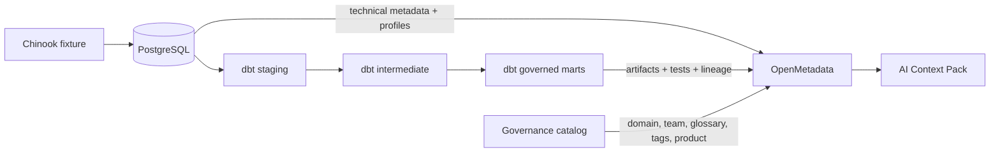
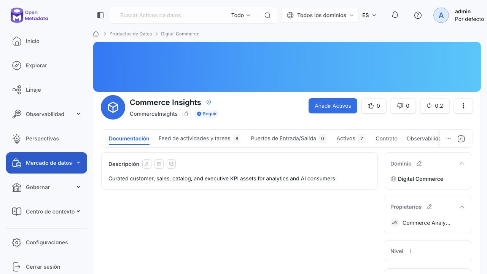
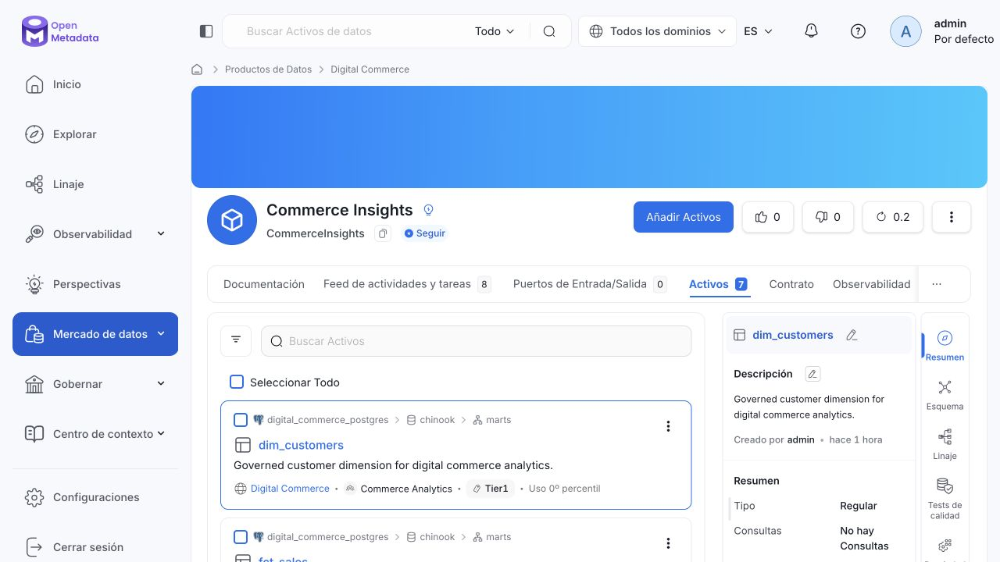
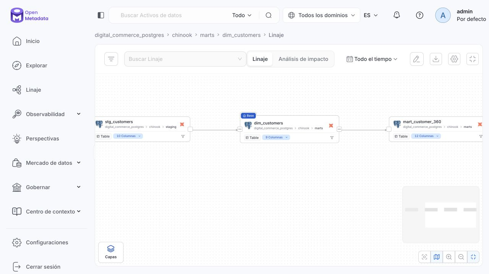
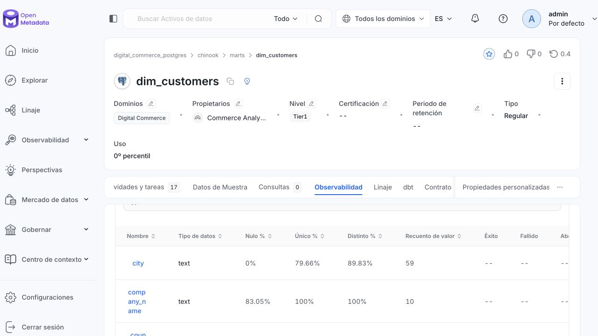

# OpenMetadata Data Context for AI

[](https://github.com/hakigreg/openmetadata-data-context-for-ai/actions/workflows/ci.yml)
[](https://github.com/open-metadata/OpenMetadata/releases/tag/2.0.2-release)
[](LICENSE)

A reproducible portfolio implementation of OpenMetadata that turns a small
digital commerce warehouse into governed, AI-ready data context.

The project is intentionally platform-led: Chinook provides representative
commerce data, PostgreSQL and dbt provide a realistic analytical lifecycle,
and **OpenMetadata is the system where technical context becomes discoverable,
owned, classified, tested, and reusable by people and AI systems**.

## What this demonstrates

- PostgreSQL metadata ingestion and profiling
- dbt descriptions, tests, tags, and table/column lineage
- a consumer-aligned domain and an owned Data Product
- business glossary terms connected to analytical assets
- non-regulatory data sensitivity classification
- ownership, tiering, discoverability, and critical analytical marts
- an API-derived AI Context Pack that contains metadata, not customer rows
- repeatable local setup for Apple Silicon and Intel hosts

This positions the author as a **Data & AI Governance Architect who can design
the operating model and implement the platform hands-on**.

## Architecture



The OpenMetadata application uses its official quickstart stack. The commerce
warehouse is a separate PostgreSQL service, so platform state and business data
have explicit boundaries.

## Implementation evidence

These screenshots were captured from the running local implementation after a
clean end-to-end build. They are not mockups or generated images.

### Governed Data Product



`Commerce Insights` is assigned to the `Digital Commerce` domain, owned by the
`Commerce Analytics` team, and curates seven governed analytical assets.

<details>
<summary>View the curated asset collection</summary>



</details>

### Lineage



The lineage view connects the dbt lifecycle from `stg_customers` through the
governed `dim_customers` dimension to the consumer-facing `mart_customer_360`.

### Column profiling



Column profiles expose null, uniqueness, distinctness, and value-count metrics
without including customer values in this repository.

## Governed analytical products

| Asset | Purpose |
| --- | --- |
| `dim_customers` | Governed customer identity and geography |
| `dim_products` | Digital catalog across tracks, albums, artists, and genres |
| `fct_sales` | Authoritative line-level sales fact |
| `mart_customer_360` | Customer behavior and lifetime value |
| `mart_sales_performance` | Monthly market performance |
| `mart_catalog_performance` | Product and catalog performance |
| `mart_executive_kpis` | Executive commerce KPI summary |

## Prerequisites

- Docker Desktop or Docker Engine with Compose v2.24.4+
- `make`, `curl`, and Python 3.10+
- at least 4 CPUs and 6 GiB assigned to Docker; 10–12 GiB is recommended

The images used by this project are multi-architecture and the workflow is
designed for both `linux/arm64` and `linux/amd64`.

## Quick start

```bash
cp .env.example .env
make demo
```

Then open:

- OpenMetadata: <http://localhost:8585>
- Airflow ingestion UI: <http://localhost:8080>
- PostgreSQL: `localhost:55432`, database `chinook`

The OpenMetadata quickstart credentials are
`admin@open-metadata.org` / `admin`. They are local demo credentials only.

Useful incremental commands:

```bash
make up                    # start the stack
make dbt-build             # build and test the warehouse
make dbt-docs              # generate dbt artifacts
make ingest-metadata       # ingest PostgreSQL metadata
make governance-bootstrap  # create governance entities and Data Product
make ingest-dbt            # publish dbt lineage, tests, and documentation
make profile               # profile governed marts
make context-export        # generate artifacts/ai-context/
make validate              # run fast project checks
make down                  # stop without deleting state
```

`make reset` deletes all local demo volumes and is intentionally separate from
the normal shutdown path.

## AI Context Pack

The export step reads governed table metadata from OpenMetadata and creates:

- `artifacts/ai-context/context.json` for machines
- `artifacts/ai-context/context.md` for human review and prompt inspection

It includes descriptions, owners, domains, Data Products, classifications, and
column definitions. It deliberately excludes warehouse records and does not
require an LLM API key. This keeps OpenMetadata—not a chatbot—as the protagonist.

A versioned example from a validated run is available as
[`context.md`](examples/ai-context/context.md) and
[`context.json`](examples/ai-context/context.json). The example contains
metadata only and can be inspected without running the stack.

## Repository map

```text
compose.yaml                 local warehouse and Compose overrides
data/chinook/                pinned upstream dataset and attribution
dbt/                         transformations, documentation, and tests
governance/catalog.json      declarative governance model
openmetadata/ingestion/      metadata, dbt, and profiler workflows
scripts/openmetadata/        API bootstrap and AI context export
examples/ai-context/         versioned metadata-only output example
docs/                        architecture decisions and demo guidance
tests/                       repository contract tests
```

## Scope and security

This is a local portfolio environment, not a production deployment. It does not
claim HIPAA, PCI DSS, or any other regulatory compliance. It demonstrates data
privacy concepts through semantic classification without turning the project
into a compliance implementation.

All host-accessible services bind to the loopback interface. The platform
database and search engine remain available only inside the Docker network.

For production, replace quickstart credentials and keys, use a dedicated bot
with least privilege, externalize secrets, use durable managed dependencies,
enable enterprise authentication, and define backup and upgrade procedures.

## Version and provenance

- OpenMetadata `2.0.2`, downloaded from the official release at setup time
- dbt Core `1.12.6` and dbt PostgreSQL `1.11.0`
- PostgreSQL `16.10-alpine`
- Chinook `1.4.5`, vendored unmodified and verified by SHA-256

See [data/chinook/README.md](data/chinook/README.md) for dataset provenance and
[docs/adr/0001-platform-scope.md](docs/adr/0001-platform-scope.md) for the design
decision behind this implementation.

## License

Project code and documentation are licensed under the [MIT License](LICENSE).
The Chinook fixture retains its upstream MIT notice in
[data/chinook/LICENSE.chinook.md](data/chinook/LICENSE.chinook.md).
